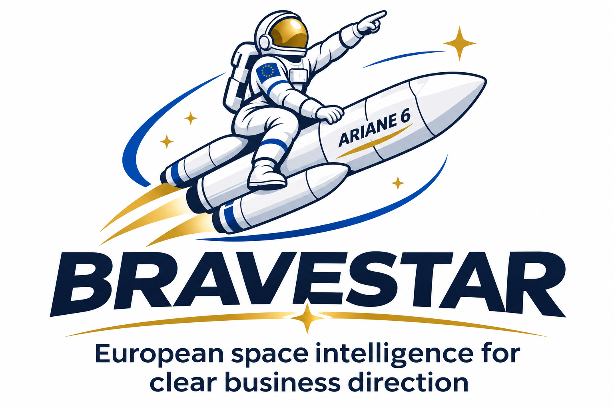

# Incubator Portfolio Strategy

> AUTHORING INSTRUCTIONS — remove this block from the client deliverable.
> Executive Standard: decision brief with essential reasoning and priority actions. Detailed Report: full assessment with evidence, alternatives and implementation steps. Use the section-specific guidance and flexible page targets in REPORT-FORMATS.md. Preserve critical risks, eligibility restrictions and binding deadlines in both; do not pad to a character count.
> Read the shared standards, REPORT-FORMATS.md and evidence gate before use. Adapt detail and citations to the selected format without reducing research quality. Populate this template with actual evidence, not plausible examples. Remove every unresolved placeholder from a final analytical report, or explicitly state Information Unavailable; a clearly labelled contract draft may retain named open terms. Use qualitative conclusions, not invented success probabilities. Record exact internal paths and tool activity only in the separate evidence archive.

Template ID: `COM-04` · Version: `1.4.0` · Area: Combined reports

## Required inputs and decision

Company/portfolio profiles; decision; selected areas; countries; timeframe; constraints and shared assumptions.

Decision this report supports: {{decision_to_support}}

## Report identity

- Prepared for: {{organisation_and_legal_entity}}
- Report ID: {{report_id}}
- Date and current-as-of cutoff: {{date_time_and_zone}}
- Geography, sector and period: {{scope}}
- Format: {{Executive_Standard_or_Detailed_Report}}
- Status: {{Draft_Preliminary_or_Final}}
- Confidentiality: {{classification}}

## Executive Summary

{{State the principal conclusion, the evidence supporting it, the strongest contrary consideration, the main uncertainty and the immediate decision required.}}

## Analysis

### Context and Scope

{{Describe the actual company/project, objectives, constraints, evidence dates and explicit exclusions. Distinguish user-supplied facts from independently checked facts.}}

### Evidence and Reasoned Assessment

### 1. Portfolio objectives and baseline

{{Write the scope-specific analysis for this section. Link material facts to public sources; explain the implication for the stated decision. Separate facts, interpretation and missing evidence.}}

### 2. Company needs and cross-portfolio opportunities

{{Write the scope-specific analysis for this section. Link material facts to public sources; explain the implication for the stated decision. Separate facts, interpretation and missing evidence.}}

### 3. Support investor and client priorities

{{Write the scope-specific analysis for this section. Link material facts to public sources; explain the implication for the stated decision. Separate facts, interpretation and missing evidence.}}

### 4. Resource plan and milestones

{{Write the scope-specific analysis for this section. Link material facts to public sources; explain the implication for the stated decision. Separate facts, interpretation and missing evidence.}}

### Evidence and Decision Matrix

| Business decision | Cross-area finding | Evidence / conflicting interpretation | Dependency / risk | Recommended action |
| --- | --- | --- | --- | --- |
| {{business_decision}} | {{cross_area_finding}} | {{evidence_conflicting_interpretation}} | {{dependency_risk}} | {{recommended_action}} |

## Sources

| Source ID | Title / issuer | Identifier / version / date | Original public link | Checked at | Finding supported / limitation |
| --- | --- | --- | --- | --- | --- |
| {{source_id}} | {{title_issuer}} | {{identifier_version_date}} | {{original_public_link}} | {{checked_at}} | {{finding_supported_limitation}} |

{{Identify material uncertainties, unread or unavailable evidence and freshness limitations without confidence ratings. Full relevant GitHub reading does not mean exhaustive external coverage.}}

## Conclusion

{{Compare credible alternatives, including postponement or no action where relevant. Explain trade-offs, dependencies and why the preferred action follows from the evidence. Do not claim eligibility or customer interest from technical similarity alone.}}

## Next Actions and Related Timelines

| Priority | Action | Suggested owner | Deadline / zone or proposed target | Dependency | Completion evidence |
| --- | --- | --- | --- | --- | --- |
| {{priority}} | {{action}} | {{suggested_owner}} | {{deadline_zone_or_proposed_target}} | {{dependency}} | {{completion_evidence}} |

Distinguish official deadlines from suggested internal targets. Assign an owner only if known; otherwise label the role as proposed.

### Contacts, if relevant

| Organisation / role | Published professional channel | Official source | Checked date | Purpose |
| --- | --- | --- | --- | --- |
| {{organisation_role}} | {{published_professional_channel}} | {{official_source}} | {{checked_date}} | {{purpose}} |

Omit this section if unnecessary. Never infer an email address. Contact research does not authorise outreach.

## AI-generated report and limitations

This report was generated with artificial intelligence assistance for information and decision-support purposes. It does not replace professional human advice, including legal, financial, investment, tax or technical advice. The sources consulted and cited are not exhaustive, and information may change after the report date. Readers should consult the original authoritative documents, current official notices and relevant professional advisers before making decisions or taking action. Assumptions, unresolved questions and coverage limitations are identified where relevant.

## Further information

For further details about this report or Bravestar, please contact angelograceffa77@gmail.com.
