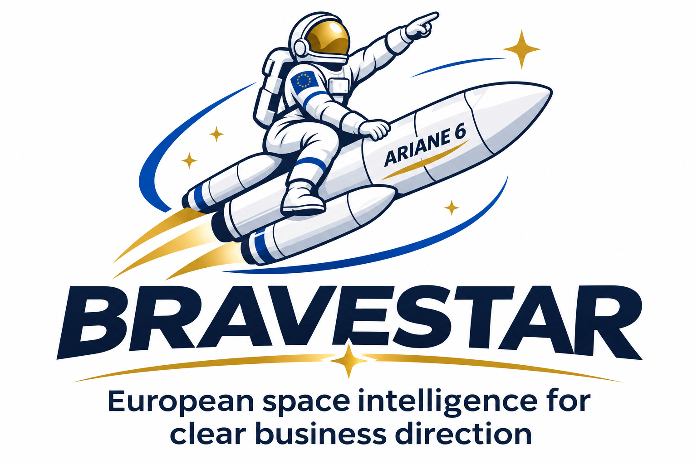

# Initial Contract Draft

> AUTHORING INSTRUCTIONS — remove this block from the client deliverable.
> Executive Standard: decision brief with essential reasoning and priority actions. Detailed Report: full assessment with evidence, alternatives and implementation steps. Use the section-specific guidance and flexible page targets in REPORT-FORMATS.md. Preserve critical risks, eligibility restrictions and binding deadlines in both; do not pad to a character count.
> Read the shared standards, REPORT-FORMATS.md and evidence gate before use. Adapt detail and citations to the selected format without reducing research quality. Populate this template with actual evidence, not plausible examples. Remove every unresolved placeholder from a final analytical report, or explicitly state Information Unavailable; a clearly labelled contract draft may retain named open terms. Use qualitative conclusions, not invented success probabilities. Record exact internal paths and tool activity only in the separate evidence archive.

Template ID: `LAW-07` · Version: `1.5.0` · Area: Law

> REPORT-SPECIFIC AUTHORING CHECKS — remove this block from the client report.
> Additional intake: Drafting brief parties terms governing law and models. Request only missing information that materially affects this assignment.
> Benchmark basis: [IP](../01_Shared-Standards/TEMPLATE-BENCHMARKS.md#ip), [LAW](../01_Shared-Standards/TEMPLATE-BENCHMARKS.md#law). These are editorial adaptations, not claims of universal industry compliance. Recheck actual jurisdiction, call and recipient rules.
> LAW-07-R1: Document model selection, jurisdiction, date and reuse conditions.
> LAW-07-R2: Prepare coherent definitions, operative clauses and schedules with explicit open terms.
> LAW-07-R3: Check document hierarchy, execution and separate negotiation notes.
> LAW-07-R4: Populate or justify the tailored matrix fields: Clause/topic,Agreed instruction,Model adaptation,Open term,Review needed.
> LAW-07-R5: Unagreed commercial terms must remain marked; legal review warning required.
> Executive Standard: lead with document model selection, jurisdiction, date and reuse conditions. Summarise other checks without losing material risks or deadlines.
> Detailed Report: develop the evidence, alternatives and implementation implications for every applicable check. Do not repeat the same facts under multiple headings.
> Keep a private requirement-by-requirement review tied to the final artifact. Missing material evidence means hold or a clearly labelled preliminary deliverable, never an unsupported final conclusion.

## Required inputs and decision

Exact activity; jurisdictions; legal entity; transaction or documents under review; relevant factual evidence.

Decision this report supports: {{decision_to_support}}

Require parties, transaction, governing-law preference and material commercial terms. Check GitHub model origin, edition, jurisdiction, purpose and reuse conditions. Never treat an obsolete or call-specific model as generally applicable. Use marked placeholders for unagreed terms; keep drafting notes separate from the draft.

**Initial draft—professional legal review required before use or signature.**

## Report identity

- Prepared for: {{organisation_and_legal_entity}}
- Report ID: {{report_id}}
- Date and current-as-of cutoff: {{date_time_and_zone}}
- Geography, sector and period: {{scope}}
- Format: {{Executive_Standard_or_Detailed_Report}}
- Status: {{Draft_Preliminary_or_Final}}
- Confidentiality: {{classification}}

## Executive Summary

{{State the principal conclusion, the evidence supporting it, the strongest contrary consideration, the main uncertainty and the immediate decision required.}}

## Analysis

### Context and Scope

{{Describe the actual company/project, objectives, constraints, evidence dates and explicit exclusions. Distinguish user-supplied facts from independently checked facts.}}

### Evidence and Reasoned Assessment

### 1. Drafting brief and model suitability

{{Write the scope-specific analysis for this section. Link material facts to public sources; explain the implication for the stated decision. Separate facts, interpretation and missing evidence.}}

### 2. Initial agreement

**INITIAL DRAFT — LEGAL REVIEW REQUIRED**

Agreement type: {{agreement_type}}
Parties: {{exact_legal_names_addresses_and_registration_details}}
Governing law: {{proposed_or_agreed_law_not_assumed}}

1. Definitions and interpretation — {{transaction-specific definitions}}
2. Purpose and scope — {{agreed activity}}
3. Roles and obligations — {{party-specific obligations}}
4. Deliverables and acceptance — {{criteria and procedure}}
5. Fees, contributions and payment — {{agreed terms or open points}}
6. Intellectual property and data rights — {{background, results, licences and restrictions}}
7. Confidentiality and applicable compliance — {{scope and exceptions}}
8. Liability, warranties and insurance — {{proposed allocation requiring review}}
9. Governance, changes and disputes — {{decision process and dispute mechanism}}
10. Term, termination and consequences — {{duration and exit effects}}
11. Notices and general provisions — {{transaction-appropriate terms}}
12. Signature blocks — {{authorised signatories}}

Schedules: {{scope, deliverables, milestones, contributions and other applicable schedules}}

These are drafting slots, not universally required or legally approved clauses. Adapt or omit inapplicable headings and explain changes in the separate drafting note.

### 3. Schedules and transaction-specific terms

{{Write the scope-specific analysis for this section. Link material facts to public sources; explain the implication for the stated decision. Separate facts, interpretation and missing evidence.}}

### 4. Separate drafting and negotiation note

{{Write the scope-specific analysis for this section. Link material facts to public sources; explain the implication for the stated decision. Separate facts, interpretation and missing evidence.}}

### Evidence and Decision Matrix

| Requirement / clause | Jurisdiction and legal status | Company fact | Analysis / alternative interpretation | Evidence and action |
| --- | --- | --- | --- | --- |
| {{requirement_clause}} | {{jurisdiction_and_legal_status}} | {{company_fact}} | {{analysis_alternative_interpretation}} | {{evidence_and_action}} |

### Initial Contract Draft — Specific Decision Record

{{Complete this report-specific matrix using evidence. Merge overlapping material with earlier tables; do not repeat it. Explain not-applicable fields and disclose unavailable data.}}

| Clause/topic | Agreed instruction | Model adaptation | Open term | Review needed |
| --- | --- | --- | --- | --- |
| {{clause_topic}} | {{agreed_instruction}} | {{model_adaptation}} | {{open_term}} | {{review_needed}} |

## Sources

| Source ID | Title / issuer | Identifier / version / date | Original public link | Checked at | Finding supported / limitation |
| --- | --- | --- | --- | --- | --- |
| {{source_id}} | {{title_issuer}} | {{identifier_version_date}} | {{original_public_link}} | {{checked_at}} | {{finding_supported_limitation}} |

{{Identify material uncertainties, unread or unavailable evidence and freshness limitations without confidence ratings. Full relevant GitHub reading does not mean exhaustive external coverage.}}

## Conclusion

{{Compare credible alternatives, including postponement or no action where relevant. Explain trade-offs, dependencies and why the preferred action follows from the evidence. Do not claim eligibility or customer interest from technical similarity alone.}}

## Next Actions and Related Timelines

| Priority | Action | Suggested owner | Deadline / zone or proposed target | Dependency | Completion evidence |
| --- | --- | --- | --- | --- | --- |
| {{priority}} | {{action}} | {{suggested_owner}} | {{deadline_zone_or_proposed_target}} | {{dependency}} | {{completion_evidence}} |

Distinguish official deadlines from suggested internal targets. Assign an owner only if known; otherwise label the role as proposed.

### Contacts, if relevant

| Organisation / role | Published professional channel | Official source | Checked date | Purpose |
| --- | --- | --- | --- | --- |
| {{organisation_role}} | {{published_professional_channel}} | {{official_source}} | {{checked_date}} | {{purpose}} |

Omit this section if unnecessary. Never infer an email address. Contact research does not authorise outreach.

## AI-generated report and limitations

This report was generated with artificial intelligence assistance for information and decision-support purposes. It does not replace professional human advice, including legal, financial, investment, tax or technical advice. The sources consulted and cited are not exhaustive, and information may change after the report date. Readers should consult the original authoritative documents, current official notices and relevant professional advisers before making decisions or taking action. Assumptions, unresolved questions and coverage limitations are identified where relevant.

## Further information

For further details about this report or Bravestar, please contact angelograceffa77@gmail.com.
